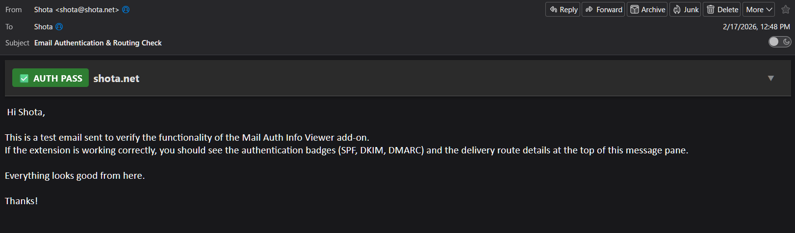
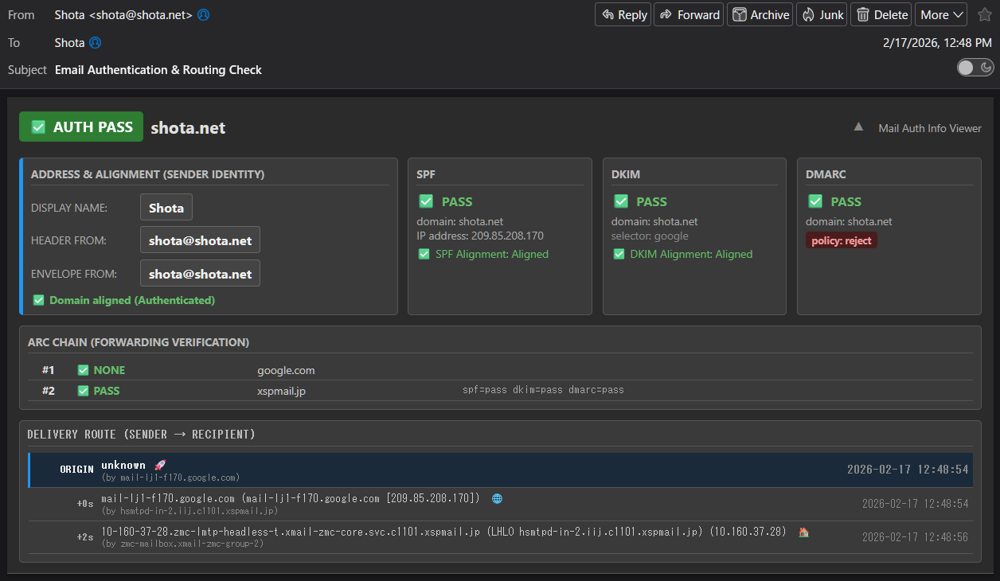
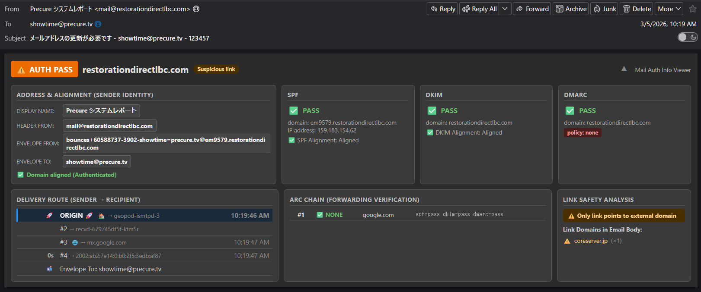
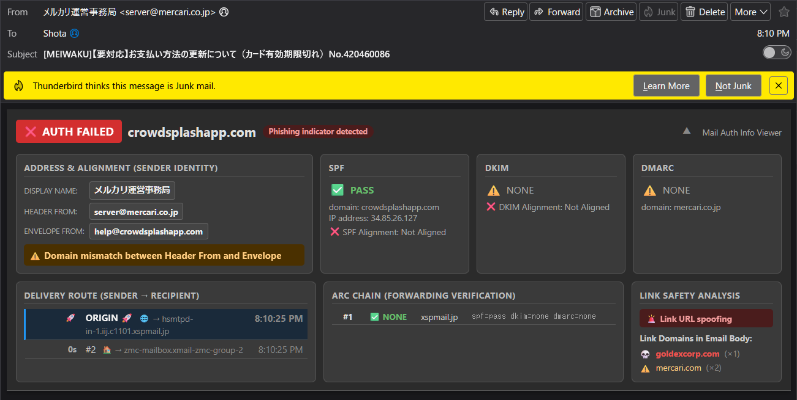
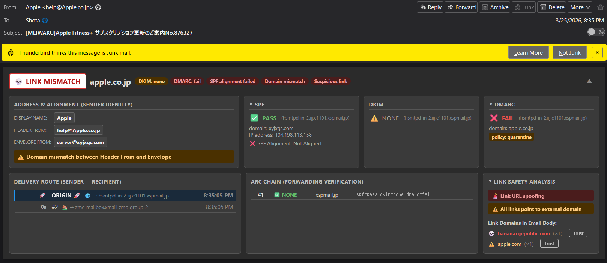

# Mail Auth Info Viewer

**A Thunderbird add-on to visualize email authentication, sender identity, and delivery routes.**
**メールの認証情報、送信者の身元、および送達経路を可視化するThunderbirdアドオンです。**

Mail Auth Info Viewer is a powerful Thunderbird add-on designed to combat sophisticated phishing and "display name" spoofing. It analyzes message headers and body content locally, presenting a clear, color-coded dashboard showing sender alignment, authentication results (SPF, DKIM, DMARC), phishing link detection, and delivery routes with time delays directly on the message view.

Mail Auth Info Viewer は、巧妙なフィッシング詐欺や「表示名（名乗り）」の偽装に対抗するために設計された強力なThunderbirdアドオンです。ローカルでメールヘッダと本文を解析し、送信者のアライメント、認証結果（SPF, DKIM, DMARC）、フィッシングリンク検知、および遅延時間を含む送達経路を、色分けされた分かりやすいダッシュボードでメッセージ画面上に直接表示します。

---

## 📸 Screenshots / スクリーンショット

### ✅ Fully Authenticated (認証成功)
The dashboard always starts collapsed to save screen space, showing only the status badge and verdict tags.
ダッシュボードは常に折りたたまれた状態で表示され、ステータスバッジと判定タグのみが見えます。


Click to expand the full dashboard with authentication details, delivery route, ARC chain, and link safety analysis.
クリックで認証詳細・送達経路・ARCチェーン・リンク安全性分析の完全なダッシュボードを展開します。


### ⚠️ Suspicious Link Detected (不審なリンク検出)
Authentication passes, but the email body contains a link indicator — either a genuinely suspicious pattern (IP-address link, IDN homograph, URL shortener) or simply an untrusted external domain. The badge shows AUTH PASS in orange with either a "Suspicious link" or "Untrusted link domain" verdict tag, depending on the nature of the finding.
認証は成功していますが、メール本文にリンク指標が含まれています — 本質的に怪しいパターン（IPアドレスリンク、IDNホモグラフ、短縮URL）か、単に未信頼の外部ドメインかのいずれかです。バッジはオレンジの認証成功に、指標の性質に応じて「不審なリンク」または「未信頼のリンクドメイン」の判定理由タグが付きます。


### ❌ Authentication Failed (認証失敗)
SPF, DKIM, or DMARC has explicitly failed. The red badge with individual verdict reason tags shows exactly what went wrong.
SPF・DKIM・DMARCのいずれかが明確に失敗しています。赤いバッジに個別の判定理由タグが表示され、何が問題かが一目瞭然です。


### 💀 Link Mismatch Detected (リンク偽装検出)
Deceptive link text detected — the displayed URL differs from the actual destination. The flashing LINK MISMATCH badge is the highest severity level, overriding all other verdicts.
リンクテキスト偽装を検出 — 表示URLと実際のリンク先が異なります。点滅するLINK MISMATCHバッジは最高レベルの深刻度で、他のすべての判定を上書きします。


---

## 🌟 Key Features / 主な機能

* **Shadow DOM CSS Isolation:** The dashboard is encapsulated in a closed Shadow DOM, completely preventing HTML email CSS (e.g., `* { font-size: 20px !important; }`) from contaminating the add-on display. The Shadow DOM host itself is placed directly under `<html>` (just before `<body>`) rather than inside the email's body, and its layout properties (display, width, max-width, margin, position, transform, etc.) are pinned with inline `!important`. This keeps the dashboard at full width even when an email constrains its body — for example, malformed HTML that contains a stray `<body style="max-width:480px">` inside a table, whose attributes the HTML parser merges into the real body element — without altering how the email itself is displayed.
    * **Shadow DOM CSS隔離:** ダッシュボードをclosed Shadow DOMでカプセル化し、HTMLメールのCSSがアドオン表示に影響することを完全に防止します。Shadow DOM のホスト要素自体もメールの body の中ではなく `<html>` 直下（`<body>` の直前）に配置し、レイアウトに関わる指定（display・width・max-width・margin・position・transform など）をインラインの `!important` で固定しています。これにより、メールが body の幅を制限している場合——例えばテーブル内に `<body style="max-width:480px">` を含む崩れた HTML で、HTML の構文解析ルールによりその属性が本来の body 要素に合流するケース——でも、メール自体の表示を変えることなくダッシュボードを全幅で表示します。
* **Per-Tab Message Binding:** Each dashboard analyzes the message displayed in its own tab or window. A message opened in a background tab is never analyzed with the headers of the message in the tab you are looking at, and if the tab cannot be identified, no dashboard is shown rather than one for a different message.
    * **タブごとのメール対応付け:** 各ダッシュボードは、自分が表示されているタブ・ウィンドウのメールを解析します。背景タブで開いたメールが、いま見ているタブのメールのヘッダで解析されることはありません。タブを特定できない場合は、別のメールの判定を出すのではなく、ダッシュボードを表示しません。
* **Always-Collapsed Panel:** The dashboard always starts collapsed for every email, keeping the status badge and verdict reason tags visible at a glance without consuming screen space. Click to expand for full details.
    * **常時折りたたみパネル:** ダッシュボードは全メールで折りたたまれた状態で表示され、ステータスバッジと判定理由タグのみが見える省スペース設計です。クリックで詳細を展開できます。
* **Manual Toggle:** You can expand or collapse the detail view at any time by clicking the header bar.
    * **手動開閉:** ヘッダーバーをクリックすることで、いつでも詳細ビューの展開・折りたたみを切り替えられます。
* **Collapsible Detail Cards:** SPF, DKIM, and DMARC cards show status at a glance with expandable details on click. Link Safety Analysis shows warnings upfront with collapsible domain/resource lists (auto-expanded when any finding is detected).
    * **折りたたみ式詳細カード:** SPF・DKIM・DMARCカードはクリックで詳細を展開。リンク安全性分析は警告を常時表示し、ドメイン/リソース一覧は折りたたみ（指標検出時は自動展開）。
* **Sender Identity & Alignment:** Instantly spot discrepancies between the Display Name, Header From, and Envelope From addresses side-by-side.
    * **送信者の身元とアライメント検証:** 「表示名」「ヘッダFrom」「エンベロープFrom」を並べて表示し、アドレスの不自然な乖離や偽装を瞬時に見抜きます。
* **Homograph (Look-alike Domain) Detection:** Detects domains that imitate another domain with look-alike characters — for example `аpple.com` with a Cyrillic "а", `аррӏе.com` written entirely in Cyrillic, `mıcrosoft.com` with a dotless "ı", or ASCII look-alikes such as `paypa1.com` and `rnicrosoft.com`. Each label is checked for mixed scripts (Latin mixed with Cyrillic, Greek, etc.; the legitimate Japanese, Chinese and Korean combinations defined by Unicode UTS #39 are allowed), for labels made only of another script's Latin-looking letters, and for look-alike Latin characters; a "skeleton" comparison (look-alike characters folded to a common form) also catches domains that resemble the sender's domain or a domain you have trusted. Punycode (`xn--`) is decoded, and internationalized domains are always shown as "Unicode (ASCII)" so you can see the real characters.
    * **Sender domain:** if the sender's own domain is a look-alike, the badge becomes 💀 LOOKALIKE DOMAIN with a "Look-alike sender domain" reason tag, even when SPF/DKIM/DMARC all pass — an attacker can register such a domain and authenticate it correctly, so authentication alone cannot vouch for it.
    * **Links:** a link (or a URL in the text) to a domain that resembles the sender's domain or a trusted domain is a critical finding (💀 LINK MISMATCH, not suppressible by the trust list). Links to internationalized domains remain suspicious; the finding states whether look-alike characters were found.
    * **Reply-To:** a Reply-To domain that uses look-alike characters or resembles the sender's domain is flagged in the sender identity card and keeps the badge from turning green (⚠️ with a "Look-alike Reply-To domain" reason tag), since replies could be steered to an attacker.
    * **ホモグラフ（見た目の似たドメイン）検出:** 見た目の似た文字で別のドメインになりすますドメインを検出します。例: キリル文字の「а」を使った `аpple.com`、すべてキリル文字で書かれた `аррӏе.com`、点のない「ı」を使った `mıcrosoft.com`、ASCII だけで似せた `paypa1.com` や `rnicrosoft.com` など。ラベルごとに、文字種の混在（ラテン文字とキリル文字・ギリシャ文字などの混在。Unicode UTS #39 が定める日本語・中国語・韓国語の正当な組み合わせは除外）、ラテン文字に見える別の文字種の字だけで構成されたラベル、紛らわしいラテン文字を検査します。さらに、紛らわしい字を共通の形にそろえた「骨格」を比べ、送信者のドメインや信頼済みドメインに似せた別ドメインも検出します。Punycode（`xn--`）はデコードし、国際化ドメインは常に「Unicode (ASCII)」の形で表示して、実際の文字を確認できるようにしています。
        * **送信者ドメイン:** 送信者自身のドメインが偽装ドメインの場合、SPF/DKIM/DMARC がすべて pass していても、バッジを 💀 なりすましドメイン にし、「送信者ドメインの偽装」の判定理由タグを付けます。攻撃者はこうしたドメインを取得して認証を正しく設定できるため、認証結果だけでは安全と言えないからです。
        * **リンク:** 送信者のドメインや信頼済みドメインに似せた別ドメインへのリンク（本文中の URL を含む）は critical（💀 リンク先相違。信頼リストでは解消しない）として扱います。国際化ドメインへのリンクは引き続き suspicious とし、紛らわしい文字が見つかったかどうかを所見の文言で区別します。
        * **Reply-To:** 紛らわしい文字を使った、または送信者のドメインに似せた Reply-To のドメインを、送信者情報カードで警告します。返信が攻撃者に誘導されるおそれがあるため、バッジはグリーンにせず、「Reply-To ドメインの偽装」の判定理由タグを付けた警告表示にします。
* **Display Name Spoofing Detection:** Detects when the display name contains an email address from a different domain than the actual sender — a common phishing trick to mislead recipients.
    * **表示名なりすまし検知:** 表示名に実際の送信元とは異なるドメインのメールアドレスが含まれている場合を検知します。受信者を欺くためのフィッシング手口です。
* **Domain Verification Badge:** Prominently displays the actual authenticated domain (e.g., `✅ AUTH PASS example.com`) to prevent false trust in fake display names.
    * **ドメイン認証バッジ:** 単なる「認証済」ではなく、実際に認証されたドメイン名を明記し、誤った安心感を与えません。
* **Verdict Reason Display:** Shows why the badge is not green — e.g., "DMARC policy is p=none", "Phishing indicator detected", "Untrusted link domain" — so administrators know exactly what to fix or trust.
    * **判定理由の表示:** バッジがグリーンでない理由（例：「DMARCポリシーがp=none」「フィッシング指標を検出」「未信頼のリンクドメイン」）を表示し、管理者が何を修正または信頼すべきか明確にします。
* **Four-Tier Link Safety Analysis:** Scans email body with severity-aware categorization:
    * **critical** — deceptive link text, links to look-alikes of the sender's or a trusted domain, dangerous URI schemes (`javascript:`, `data:`), embedded HTML forms (promoted to phishing badge)
    * **suspicious** — IP-address links, internationalized-domain (IDN) links — distinguishing those with look-alike characters (homographs) — and URL shorteners (patterns inherently risky regardless of trust)
    * **untrusted** — all links external, main CTA external (a single domain unknown to the extension, resolvable by trusting the domain)
    * **privacy** — tracking pixels (informational notice, does not affect verdict)
    * **4段階リンク安全性分析:** メール本文を深刻度別にスキャン:
    * **critical** — リンクテキスト偽装、送信者や信頼済みドメインに似せた別ドメインへのリンク、危険なURIスキーム（`javascript:`、`data:`）、HTMLフォーム埋め込み（フィッシングバッジに昇格）
    * **suspicious** — IPアドレスリンク、国際化ドメイン（IDN）へのリンク（紛らわしい文字を含むホモグラフかどうかを区別して表示）、短縮URL（信頼リストでは解消しない本質的に怪しいパターン）
    * **untrusted** — 全リンク外部、メインCTA外部（ドメインが未知なだけ。信頼リスト追加で解消）
    * **privacy** — トラッキングピクセル（プライバシー上の注意喚起。判定には影響しない）
* **Link Domain Overview:** Lists all unique link domains found in the email body, color-coded by whether they match the sender's organizational domain, with inline tracker markers for tracking pixel sources.
    * **リンクドメイン一覧:** メール本文に含まれるすべてのリンクドメインを一覧表示し、送信者の組織ドメインとの一致/不一致を色分けします。トラッキングピクセル配信元はインラインマーカーで示します。
* **Reply-To Mismatch Detection:** Warns when the Reply-To address belongs to a different domain than the sender, a technique used to redirect replies to attackers.
    * **Reply-To不一致検知:** Reply-Toアドレスが送信者と異なるドメインの場合に警告します。返信を攻撃者に誘導するフィッシング手口です。
* **Trusted Link Domains with Inline Shortcut:** When an untrusted link indicator involves a single external domain, a Trust button appears directly on the finding row for one-click whitelisting. Otherwise, individual Trust buttons appear next to each external domain in the domain list. Whitelisted domains suppress untrusted-link warnings; deceptive link text (displayed URL differing from the actual destination) is always flagged regardless of the trust list, because a mismatch between what is shown and where a link goes is deceptive no matter who owns the destination. Manage trusted domains from the add-on settings page with text-based import/export.
    * **信頼済みリンクドメインとインラインショートカット:** 未信頼のリンク指標が外部ドメイン1つに特定できる場合、findings行に直接Trustボタンが表示され、ワンクリックでホワイトリスト登録できます。それ以外の場合はドメイン一覧の各外部ドメイン横のTrustボタンを使用します。ホワイトリスト登録済みドメインは未信頼リンク警告を抑制します。一方、リンクテキスト偽装（表示URLと実際のリンク先の不一致）は、リンク先の所有者に関わらず「見せている先と飛ぶ先が違う」こと自体が欺瞞であるため、信頼リストに関係なく常に警告します。アドオン設定画面からテキスト形式のインポート/エクスポートで管理可能。
* **Authentication Status:** Quickly check the pass/fail status of SPF, DKIM, and DMARC authentication with DMARC policy display.
    * **認証ステータス:** SPF、DKIM、DMARCの成否ステータスをDMARCポリシー表示と共に素早く確認できます。
* **DMARC Alignment Indicators (RFC 7489):** SPF and DKIM alignment status shown within each authentication card. Alignment is evaluated only for signatures that passed authentication — failed signatures are excluded from alignment consideration. The security verdict requires DMARC pass and at least one alignment match for AUTH PASS.
    * **DMARCアライメント表示 (RFC 7489):** SPFとDKIMのアライメント状態を各認証カード内に表示。アライメント評価は認証に成功した署名のみが対象で、失敗した署名はアライメント判定から除外されます。セキュリティ判定にはDMARC passと少なくとも一方のアライメント一致が必要です。
* **Individual DKIM Signatures:** When multiple DKIM signatures exist, each is displayed individually with its pass/fail status, signing domain, and DKIM selector (`s=`), with deduplication across headers.
    * **個別DKIM署名表示:** 複数のDKIM署名がある場合、各署名のpass/fail状態・署名ドメイン・DKIMセレクター (`s=`) を個別に表示。ヘッダ間の重複は自動排除します。
* **ARC Chain Visualization (RFC 8617):** Displays the Authenticated Received Chain with verification status, signing domain, and authentication summary for each forwarding hop.
    * **ARCチェーン表示 (RFC 8617):** メール転送時のAuthenticated Received Chainを、検証状態・署名ドメイン・認証サマリーとともに表示します。
* **Delivery Route Visualization:** View the email's path from the sender (ORIGIN) to your inbox, including calculated time delays between each hop, Envelope-To recipient, and IP type indicators (🏠 internal / 🌐 external with IP address tooltips).
    * **送達経路の可視化:** 送信元（ORIGIN）から受信ボックスまでのメールの経路を、各ホップ間の遅延時間、受信先（Envelope-To）、IPタイプ表示（🏠内部/🌐外部、ツールチップにIPアドレス表示）とともに表示します。
* **Received-SPF Fallback:** When `Authentication-Results` headers lack SPF data, the add-on falls back to `Received-SPF` headers for compatibility with older mail servers. Because a sender can also write `Received-SPF`, only the first one located above the receiving boundary `Received` line (or above the topmost `Received` line when the whole route is internal) is used, and none is used when the raw header order cannot be read.
    * **Received-SPFフォールバック:** Authentication-ResultsにSPF結果がない場合、Received-SPFヘッダから自動的に取得し、古いメールサーバーとの互換性を確保します。`Received-SPF` も送信者が書けるため、受信境界の `Received` 行より上（経路全体が内部の場合は最上段の `Received` 行より上）にある最初の1本だけを使い、生ヘッダの順序が読めない場合は使いません。
* **Address & Alignment:** Highlights the sender's addresses. If the domain doesn't match the authenticated envelope, it alerts you to potential spoofing or mailing list routing.
    * **アドレスとアライメント:** 送信者のアドレスを強調表示します。ドメインがエンベロープと一致しない場合、なりすましやメーリングリスト経由の可能性を警告します。
* **Delivery Route:** The table at the bottom shows the path. The first row ("ORIGIN 🚀") is the sender. The time difference between each hop is shown on the left.
    * **送達経路:** 下部のテーブルが経路を示します。最初の行（"ORIGIN 🚀"）が送信元です。各ホップ間の時間差が左側に表示されます。
* **Organizational Domain Comparison (RFC 7489):** Uses a curated Public Suffix List covering 60+ countries for accurate domain alignment.
    * **組織ドメイン比較 (RFC 7489):** 60か国以上をカバーするPublic Suffix Listを使用してドメインを正確に比較します。
* **Mailing List Detection:** Indicates "via Mailing List" when `List-Id` or `List-Unsubscribe` headers are detected, explaining domain mismatches from list forwarding.
    * **メーリングリスト検知:** `List-Id` や `List-Unsubscribe` ヘッダの検出時に「メーリングリスト経由」と表示し、転送によるドメイン不一致を説明します。
* **Trusted Authentication Filtering (authserv-id):** Filters `Authentication-Results` headers to only trust those from the receiving mail server. The trusted host is located by finding the boundary MTA — reading `Received` headers from the top, the first hop that is not clearly internal to the receiving side (internal means no `from` clause, a private, shared (`100.64.0.0/10`), link-local or loopback IP, or a local handoff with no IP such as `from exim by ... with sa-scanned`) — so that internal handoffs added *after* authentication are skipped. The search never continues past that hop, even if it records no readable IP, because everything below the boundary line can be written by the sender. This correctly handles Gmail / Google Workspace (which prepend `Received: by 2002:<IPv6>` as an IP-literal internal hop) and providers such as Fastmail (where the final delivery hop, e.g. a Cyrus LMTP host like `slotpiXXmYY`, differs from the authenticating host such as `phl-mx-NN.messagingengine.com`, with several `*.internal` hops in between). When every hop is internal (e.g. self-sent mail routed entirely inside the provider), only an `Authentication-Results` header located above the topmost `Received` line is trusted. Host names are cut off at a comment that follows them without a space, as RFC 5321 allows (e.g. `by mfsmax.docomo.ne.jp(DOCOMO Mail Server Ver2.0)`), so that such servers' own `Authentication-Results` are matched correctly. Without this, the legitimate `Authentication-Results` would be matched against the wrong host, discarded, and SPF/DKIM/DMARC would wrongly show as `none`.
    * **信頼できる認証結果のフィルタリング (authserv-id):** 受信メールサーバーの `Authentication-Results` ヘッダのみを信頼します。信頼するホストは「境界 MTA」——`Received` を上から見て、受信側の内部処理と言い切れない最初のホップ（内部処理とは、`from` 句が無い、プライベート IP・共有アドレス（`100.64.0.0/10`）・リンクローカル・ループバックからの受信、`from exim by ... with sa-scanned` のような IP の無いローカルの受け渡し）——を特定して決定し、認証の*後*に付与される内部ハンドオフを読み飛ばします。境界の行より下は送信者が書けるため、境界の行に読み取れる IP が無くても、それより下へは探しに行きません。これにより Gmail / Google Workspace（IP リテラルの内部ホップ `Received: by 2002:<IPv6>` を最上段に積む）や、Fastmail のように最終配送ホップ（例: Cyrus LMTP の `slotpiXXmYY`）が認証ホスト（例: `phl-mx-NN.messagingengine.com`）と異なり間に複数の `*.internal` ホップを挟む構成にも正しく対応します。経路全体が内部処理の場合（例: プロバイダ内で完結する自己送信メール）は、最上段の `Received` 行より上にある `Authentication-Results` だけを信頼します。RFC 5321 で認められている「ホスト名の直後に空白なしでコメントが続く」書式（例: `by mfsmax.docomo.ne.jp(DOCOMO Mail Server Ver2.0)`）では、コメントの手前でホスト名を区切り、そうした受信サーバー自身の `Authentication-Results` を正しく照合します。これを行わないと、正規の `Authentication-Results` が誤ったホストと照合されて破棄され、SPF/DKIM/DMARC が誤って `none` 表示になってしまいます。
* **Placement-verified trust for `Authentication-Results`:** Anyone can write an `Authentication-Results` header into a message, and receiving servers remove only those that claim their own authserv-id, so a name match alone cannot tell a genuine header from a forged one. Outside the provider-specific rules below, the add-on reads the raw header order (`messages.getRaw`, header block only, fetched whenever the message has an `Authentication-Results` or `Received-SPF` header) and trusts only headers that pass these checks:
    * **Name:** the authserv-id must equal the boundary host exactly (case and a trailing dot are ignored). Parent or sub-domains are not accepted — otherwise a forged header naming just `com` or `ne.jp` would match every server under it.
    * **Position:** every header with that name above the boundary `Received` line is considered. Some receiving servers split the results of a single check across several `Authentication-Results` headers — Fastmail, for example, writes `x-ptr`, `bimi`, `arc` and `dkim`/`dmarc`/`spf` as separate headers — so taking only one of them would drop the DKIM or DMARC result. If there is none above the boundary line, only the first header with that name directly below it (before the next `Received`) is considered. Headers further down belong to the original message.
    * **Evidence:** a header above the boundary `Received` line was added after the message was received and cannot be written by the sender, so it is trusted. A header directly below the boundary line — where Gmail and many Postfix-based servers put theirs — shares its position with a forged header placed at the very top of the original message, so it is trusted only if an `ARC-Authentication-Results` header with the same authserv-id sits above the boundary line, showing that the receiving server actually processed the message. Only one header is taken from this position, because a forged header placed right after the receiving server's own could not be told apart from it. Without such evidence (for example servers that add their header below the boundary line with no ARC set above it), the result is not trusted and is shown only in the `ℹ️ Reported, unverified` pill.
    * If the raw header order cannot be read, or its `Received` lines do not match the parsed headers, nothing is trusted.
* **受信位置を確かめた `Authentication-Results` の信頼:** `Authentication-Results` は誰でもメールに書けて、受信サーバーが取り除くのは自身の authserv-id を名乗るものだけです。そのため、名前が一致するだけでは本物と偽物を区別できません。下記のプロバイダ固有ルールに該当しない場合、生のヘッダ順序（`messages.getRaw` でヘッダ部のみ。`Authentication-Results` か `Received-SPF` があるメールでは毎回取得）を読み、次の条件を満たすヘッダだけを信頼します。
    * **名前:** authserv-id が境界ホスト名と完全一致すること（大文字小文字と末尾のドットは無視）。親ドメインやサブドメインは認めません。認めると、`com` や `ne.jp` を名乗るだけの偽ヘッダが、その配下のすべてのサーバーに一致してしまいます。
    * **位置:** 境界の `Received` 行より上にある、名前の一致するヘッダはすべて候補にします。受信サーバーによっては1回の検証結果を複数の `Authentication-Results` に分けて書くため（例えば Fastmail は `x-ptr`・`bimi`・`arc`・`dkim`/`dmarc`/`spf` を別々のヘッダにします）、1本に絞ると DKIM や DMARC の結果を取りこぼします。境界の行より上に無い場合は、境界の行の直下（次の `Received` の手前）にある、名前の一致する最初の1本だけを候補にします。それより下は元メールの一部です。
    * **証拠:** 境界の `Received` 行より上のヘッダは受信後に付与されたもので、送信者は書き込めないため信頼します。境界の行の直下——Gmail や多くの Postfix 系サーバーが付与する位置——は、元メールの先頭に置かれた偽ヘッダとも重なるため、境界の行より上に同じ authserv-id の `ARC-Authentication-Results` があり、受信サーバーが実際に処理したと分かる場合に限って信頼します。この位置から採るのは1本だけです。受信サーバーのヘッダのすぐ後ろに送信者の偽ヘッダが続いていても、区別できないためです。こうした証拠が無い場合（境界の直下に付与し、境界より上に ARC を付けないサーバーなど）は信頼せず、`ℹ️ 報告・未検証` のピルで表示するだけにします。
    * 生ヘッダの順序が読めない場合や、その `Received` の本数が解析したヘッダと一致しない場合は、どのヘッダも信頼しません。
* **Microsoft 365 / Exchange Online Inbound Support:** Exchange Online cannot be handled by the generic boundary logic for two reasons: after its inbound gateway (EOP, `*.mail.protection.outlook.com`) the message passes through several internal hops (`*.prod.outlook.com`, `*.outlook.office365.com`) connected over globally routable IPv6, and the `Authentication-Results` header it adds carries **no authserv-id at all** (it begins directly with `spf=pass (sender IP is ...)`). The add-on therefore uses a dedicated, strict rule: starting from the topmost `Received` header (written by your actual receiving server and not forgeable from outside), it walks down the chain only while every hop is a Microsoft host and each hop's sender matches the next hop's receiver (same server name). Only if this contiguous walk reaches the hop where the message entered EOP from outside Microsoft does it consider the single topmost `Authentication-Results` header without an authserv-id, attributing it to that EOP host. Before trusting it, the add-on reads the raw header order (`messages.getRaw`, header block only, fetched when a provider rule applies or the message has an `Authentication-Results` or `Received-SPF` header) and confirms that this header sits **above** the EOP entry `Received` line — i.e. it was added after Microsoft received the message. A forged header injected into the original message always sits below that line, so it is never trusted even if Microsoft added no header of its own. Any break in the chain, a non-EOP entry point (e.g. authenticated client submission), a server receiving from itself (the internal submission origin, below which headers are client-supplied), a topmost header that names a different authserv-id, a header in the wrong position, or raw headers that cannot be read leaves the result untrusted as before.
    * **Microsoft 365 / Exchange Online 受信メールへの対応:** Exchange Online は次の2点で汎用の境界検出が通用しません。受信ゲートウェイ（EOP、`*.mail.protection.outlook.com`）の後ろにグローバル IPv6 で接続された内部ホップ（`*.prod.outlook.com`、`*.outlook.office365.com`）が多段に続くこと、そして付与する `Authentication-Results` に **authserv-id が存在しない**こと（`spf=pass (sender IP is ...)` からいきなり始まる）です。そこで専用の厳格なルールを用います。最上段の `Received`（実際の受信サーバーが書くため外部から偽造できない）から下へ、全ホップが Microsoft のホストで、かつ各ホップの送信元と次のホップの受信ホストが同一サーバー名である間だけたどります。この連続した走査で「Microsoft 外から EOP に入った受信ホップ」に到達できた場合に限り、authserv-id を持たない最上段の `Authentication-Results` 1本を、その EOP ホストが付与したものとして採用候補にします。信頼する前に、生のヘッダ順序（`messages.getRaw` でヘッダ部のみ。プロバイダ固有ルールが該当する場合か、`Authentication-Results` か `Received-SPF` がある場合に取得）を読み、そのヘッダが EOP 受信の `Received` 行より**上**にある（＝Microsoft が受信した後に付与した）ことを確認します。元メールに注入された偽造ヘッダは必ずその行より下に位置するため、Microsoft が自身のヘッダを付与しなかった場合でも偽物は信頼されません。連続性の途切れ、EOP 以外からの受付（認証済みクライアントからの送信受付など）、同一サーバーが自身から受け取ったホップ（組織内送信の起点。これより下はクライアントが含めたヘッダ）、別の authserv-id を名乗る最上段ヘッダ、位置の不一致、生ヘッダが読めない場合のいずれかがあれば、従来どおり信頼しません。
* **mailbox.org Inbound Support:** mailbox.org has the same structure: after its inbound MX (`mx*.mailbox.org`) the message passes through internal hops (`*.heinlein-hosting.de`) connected over public IPv6, and its `Authentication-Results` uses the fixed, non-hostname authserv-id `incoming_mbo`. The same contiguous-chain walk locates the MX entry hop. Because mailbox.org's filter inserts its header **directly below** the MX's own `Received` line — a position that a forged header placed at the very top of the original message could also occupy — the add-on additionally requires the `X-Rspamd-Queue-Id` header (exactly one) to equal the queue ID that the MX recorded in that `Received` line (`with ESMTPS id ...`). This ID is assigned only when the message is received and cannot be predicted by the sender, so a match proves that mailbox.org actually processed the message, in which case its own header is the first one directly below the MX line. Only then is that `incoming_mbo` header trusted.
    * **mailbox.org 受信メールへの対応:** mailbox.org も同じ構造で、受信 MX（`mx*.mailbox.org`）の後ろに公開 IPv6 で接続された内部ホップ（`*.heinlein-hosting.de`）が続き、`Authentication-Results` の authserv-id はホスト名ではない固定値 `incoming_mbo` です。同じ連続チェーン走査で MX の受信ホップを特定します。mailbox.org のフィルタは自身のヘッダを MX の `Received` 行の**直下**に挿入しますが、この位置は元メール先頭に置かれた偽造ヘッダと重なり得るため、さらに `X-Rspamd-Queue-Id` ヘッダ（ちょうど1本）の値が、MX がその `Received` 行に記録したキュー ID（`with ESMTPS id ...`）と一致することを要求します。この ID は受信時に初めて割り当てられ送信者には予測できないため、一致すれば mailbox.org が実際にメールを処理した証跡となり、その場合 MX 行の直下で最初に現れるヘッダが mailbox.org 自身のものになります。この条件を満たした場合に限り、その `incoming_mbo` ヘッダを信頼します。
* **Hostpoint Inbound Support:** Hostpoint's inbound MX (`mxin<NN>.mail.hostpoint.ch`, Exim) adds `Authentication-Results` under the cluster name `mxin-hosts.mail.hostpoint.ch` rather than its own host name, so the generic authserv-id match always discarded it and DKIM/DMARC showed `none`. After scanning a message with SpamAssassin, the MX hands it back to itself (`Received: from mailnull by mxin<NN>.mail.hostpoint.ch with local_accounts_spamscanned`, no IP) and then passes it to internal hops (`*.adm.hostpoint.ch`, `*.mail.hostpoint.internal`) over LMTP. The same contiguous-chain walk is used; for Hostpoint only, a self-handoff hop of this form (a local user name with no dot, no IP, and a `local*` protocol) is treated as the same server continuing, and the walk then requires the next hop to be received by that same server. The `mxin-hosts.mail.hostpoint.ch` header is trusted only if it is the first `Authentication-Results` above the MX entry `Received` line in the raw header order, the same placement check as for Microsoft 365.
    * **Hostpoint 受信メールへの対応:** Hostpoint の受信 MX（`mxin<NN>.mail.hostpoint.ch`、Exim）は、`Authentication-Results` を自身のホスト名ではなくクラスタ名 `mxin-hosts.mail.hostpoint.ch` で付与するため、汎用の authserv-id 照合では常に破棄され、DKIM/DMARC が `none` と表示されていました。MX は SpamAssassin でスキャンしたメールを自分自身へ渡し直し（`Received: from mailnull by mxin<NN>.mail.hostpoint.ch with local_accounts_spamscanned`、IP なし）、その後 LMTP で内部ホップ（`*.adm.hostpoint.ch`、`*.mail.hostpoint.internal`）へ渡します。同じ連続チェーン走査を用い、Hostpoint に限って、この形の自己再投入ホップ（ドットを含まないローカルユーザー名・IP の記録なし・`local*` プロトコル）を同一サーバーでの処理の続きとして扱い、次のホップにも同じサーバーが受信したことを求めます。`mxin-hosts.mail.hostpoint.ch` のヘッダは、生のヘッダ順序で MX 受信の `Received` 行より上にある最初の `Authentication-Results` である場合に限って信頼します（Microsoft 365 と同じ位置検証）。
* **GMX Inbound Support:** GMX's inbound MX (shared by gmx.net, gmx.de, gmx.at and gmx.ch addresses) records the fixed name `mx-ha.gmx.net` in the `by` part of its `Received` line, with the individual node only in the comment (for example `(mxgmx108 [...])`), and adds `Authentication-Results` under the domain name `gmx.net` rather than a host name. There are no internal hops after it, but the generic authserv-id match never succeeded, so every GMX-received message showed SPF/DKIM/DMARC as `none` and an UNVERIFIED verdict. The same contiguous-chain walk locates the hop where the message entered `mx-ha.gmx.net` (matched exactly) from outside GMX, and the `gmx.net` header is trusted only if it is the first `Authentication-Results` above that `Received` line in the raw header order, the same placement check as for Microsoft 365. International GMX domains such as gmx.com use different inbound servers whose header format has not been confirmed, so they are not covered by this rule.
    * **GMX 受信メールへの対応:** GMX の受信 MX（gmx.net・gmx.de・gmx.at・gmx.ch のアドレスで共通）は、`Received` 行の `by` に固定名 `mx-ha.gmx.net` を記録し、個々のノードはコメント（例: `(mxgmx108 [...])`）にだけ書きます。`Authentication-Results` はホスト名ではなくドメイン名 `gmx.net` で付与します。後ろに内部ホップは続きませんが、汎用の authserv-id 照合が一致しないため、GMX で受信したメールはすべて SPF/DKIM/DMARC が `none`、判定が UNVERIFIED になっていました。同じ連続チェーン走査で、GMX の外から `mx-ha.gmx.net`（完全一致）に入ったホップを特定し、`gmx.net` のヘッダは、生のヘッダ順序でその `Received` 行より上にある最初の `Authentication-Results` である場合に限って信頼します（Microsoft 365 と同じ位置検証）。gmx.com などの国際版ドメインは別の受信サーバーを使い、ヘッダの書式を確認できていないため、このルールの対象外です。
* **Forged headers naming the boundary host:** For these providers the genuine authserv-id never equals the inbound host name, so an `Authentication-Results` header that names the boundary host (for example `mx1.mailbox.org` or `mxin016.mail.hostpoint.ch`) can only be one the sender placed in the original message — the provider removes only headers that claim its own authserv-id. Whenever a provider route is identified, the add-on therefore skips the name-based authserv-id match entirely and trusts only the header that passed the provider's placement check. If that check fails, no header is trusted. Headers that were left out are still shown in the `ℹ️ Reported, unverified` pill when the trusted result is `none`.
    * **境界ホスト名を名乗る偽造ヘッダ:** これらのプロバイダでは、本物の authserv-id が受信ホスト名と一致することはありません。そのため、境界ホストの名前（例: `mx1.mailbox.org`、`mxin016.mail.hostpoint.ch`）を名乗る `Authentication-Results` は、送信者が元メールに仕込んだものでしかありえません（プロバイダが取り除くのは自身の authserv-id を名乗るヘッダだけです）。プロバイダの経路を特定できた場合は、名前による authserv-id 照合を一切行わず、プロバイダの位置検証を通ったヘッダだけを信頼します。位置検証を通らなければ、どのヘッダも信頼しません。信頼しなかったヘッダは、信頼済みの判定が `none` の場合に、従来どおり `ℹ️ 報告・未検証` のピルで表示されます。
* **Microsoft 365 Internal Delivery Note:** When the whole delivery route stays inside Microsoft 365 (no hop entered from outside, contiguous Microsoft-internal chain, and no `Authentication-Results` at all), SPF/DKIM/DMARC simply do not apply. Instead of the generic "Domain aligned, but sender is not authenticated" wording, the sender identity card shows an informational `ℹ️ Microsoft 365 internal delivery` note so that intra-organization mail is not confused with external mail that failed verification. The badge stays UNVERIFIED and the reason tags are unchanged: Exchange organization headers such as `X-MS-Exchange-Organization-AuthAs` are not trusted, so internal delivery is described, not vouched for.
    * **Microsoft 365 組織内配送の注記:** 配送経路全体が Microsoft 365 内部で完結している場合（外部から入ったホップがなく、Microsoft 内部ホップが連続し、`Authentication-Results` が1本もない場合）、SPF/DKIM/DMARC はそもそも適用されません。汎用の「ドメイン一致・送信者未認証」という文言の代わりに、送信者情報カードに `ℹ️ Microsoft 365 組織内の配送` の情報注記を表示し、検証に失敗した外部メールと組織内メールを混同させないようにします。バッジは UNVERIFIED のまま、判定理由タグも変わりません。`X-MS-Exchange-Organization-AuthAs` などの Exchange 組織ヘッダは信頼しないため、組織内配送であることを説明するに留め、その正当性を保証するものではありません。
* **Forwarding Service Original-Sender Check:** Email aliasing / forwarding services verify the original message when they receive it and then re-send it under their own domain, so the outer authentication only proves that the forwarding service sent it. When the message carries such a service's record of the original results (currently addy.io's `X-AnonAddy-Authentication-Results`), the add-on shows it in the sender identity card and the copied report as "Original sender (reported by forwarding service)" and requires the original sender's DMARC to be `pass` (in every instance of the header) for a green badge; otherwise the verdict stays at ⚠️ AUTH PASS with the `Original sender not verified (forwarding service)` reason tag. Because this header cannot be cryptographically verified, it is only ever used to make the verdict stricter — a message without it is judged exactly as before.
    * **転送サービス経由メールの元送信者チェック:** メールエイリアス／転送サービスは元メールを受信した時点で検証し、自身のドメインで再送するため、外側の認証が証明するのは「転送サービスが送った」ことまでです。転送サービスが記録した元メールの認証結果（現在は addy.io の `X-AnonAddy-Authentication-Results`）がある場合、送信者情報カードとコピー用レポートに「元送信者（転送サービスの報告値）」として表示し、グリーン判定には元送信者の DMARC が（同名ヘッダのすべてで）`pass` であることを追加で要求します。満たさない場合は ⚠️ AUTH PASS に留め、判定理由タグ `元送信者未検証（転送サービス）` を表示します。このヘッダは暗号学的に検証できないため、判定を厳しくする方向にのみ用い、ヘッダがないメールの判定は従来と変わりません。
* **Reported-but-unverified results notice:** When a method's trusted verdict is `none` but a result is present only in an untrusted source — a standard `Authentication-Results` header whose `authserv-id` could not be tied to your receiving server, or the `ARC-Authentication-Results` chain — the value is surfaced as a compact, dotted-underlined `ℹ️ Reported, unverified` pill in the header (full caveat on hover). This avoids misleading bare `none` for legitimate mail whose receiving infrastructure records results in a non-standard place, while keeping the conservative principle intact: these reported values are clearly marked as not independently verified and **do not affect the badge, the cards, or the verdict** (ARC results in particular are forgeable and not cryptographically checked here).
    * **報告値（未検証）の通知:** ある方式の信頼済み判定が `none` でも、信頼できないソース——`authserv-id` を受信サーバーに帰属できなかった標準 `Authentication-Results` や `ARC-Authentication-Results` チェーン——にのみ結果がある場合、その値をヘッダ内に `ℹ️ 報告・未検証` のコンパクトなピル（点線下線・hover で全文の断り書き）として控えめに提示します。受信側インフラが非標準の場所に結果を記録した正規メールを、いきなり `none` だけで誤解させないための表示です。保守原則は維持し、これらの報告値は「独立検証していない」と明示したうえで、**バッジ・各カード・総合判定には一切影響させません**（特に ARC は偽造可能で本アドオンでは暗号検証していません）。
* **Signed but unverified DKIM:** Some receiving servers never write an `Authentication-Results` header and record their checks only in SpamAssassin headers such as `X-Spam-Status`. When the trusted DKIM result is `none` but the message carries a `DKIM-Signature` header, the DKIM card shows `⚠️ SIGNED (UNVERIFIED)` instead of a bare `NONE`, lists each signature's signing domain (marked unverified) and selector, and explains that the receiving server recorded no verification result, so whether the signature is valid is unknown. The copied report includes the same information. This only distinguishes "signed, not verified" from "not signed": the status stays `none`, the card keeps the neutral color, and the badge and verdict reason tags (`DKIM: none`) are unchanged. `X-Spam-*` headers are not used as an authentication source, because the sender can add them freely and the MTA that added them cannot be identified; a `DKIM-Signature` header can likewise be forged, so its presence is never treated as evidence of safety.
    * **署名あり・未検証の DKIM:** 受信サーバーによっては `Authentication-Results` ヘッダを書かず、検証結果を `X-Spam-Status` などの SpamAssassin ヘッダにだけ記録します。信頼済みの DKIM 判定が `none` なのに `DKIM-Signature` ヘッダがある場合、DKIM カードには単なる `NONE` ではなく `⚠️ 署名あり（未検証）` を表示し、各署名の署名ドメイン（未検証と明記）とセレクタを列挙したうえで、「受信サーバーが検証結果を記録していないため、署名が有効かどうかは確認できない」ことを説明します。コピー用レポートにも同じ内容を出力します。これは「署名なし」と「署名はあるが未検証」を区別するための表示で、ステータスは `none` のまま、カードの色も中立のまま、バッジと判定理由タグ（`DKIM: none`）も変わりません。`X-Spam-*` ヘッダは送信者が自由に付与でき、付与した MTA も特定できないため、認証結果の代わりには用いません。`DKIM-Signature` ヘッダ自体も偽造できるため、署名の存在を安全の根拠として扱うこともありません。
* **Authentication Strength Detection:** Flags weak authentication configurations that pass but leave fixable gaps: DKIM keys below 2048 bits (when the receiving server records the key length in Authentication-Results), deprecated rsa-sha1 signatures, partial body signing via the `l=` tag, security-relevant headers left out of the DKIM signature (`h=` tag, see below), weak DMARC subdomain policy (`sp=none` while the main policy is stronger), and partial DMARC enforcement (`pct` below 100, when recorded). Warnings appear inside the DKIM/DMARC cards as administrator guidance and do not affect the badge — the one exception is the DKIM replay condition described next.
    * **認証強度検出:** 認証は pass していても改善可能な弱さが残る設定を警告します：2048ビット未満の DKIM 鍵（受信サーバーが Authentication-Results に鍵長を記録している場合）、非推奨の rsa-sha1 署名、`l=` タグによる本文の部分署名、DKIM 署名の対象から外れた重要ヘッダ（`h=` タグ、後述）、メインポリシーより弱い DMARC サブドメインポリシー（`sp=none`）、部分施行（`pct` が 100 未満、記録がある場合）。警告は DKIM/DMARC カード内に管理者向け情報として表示され、バッジ判定には影響しません。唯一の例外は、次に述べる DKIM リプレイの条件です。
* **DKIM Signed-Header Coverage / Replay Risk:** A DKIM signature only vouches for the body and the headers listed in its `h=` tag; any header outside that list can be replaced or added without breaking the signature. In a *DKIM replay* attack, someone obtains a genuinely signed message from a brand (for example a form auto-reply sent to an address they control), changes only the unsigned headers — typically `Subject`, and `Content-Type` so that text they planted in the body is parsed as a separate MIME part and displayed instead of the original content — and re-sends it to other recipients from their own server. The From domain and the signing domain still match, so DMARC passes and even BIMI logos can appear. For each DKIM signature that passed and aligns with the From domain (matched by `header.d` and, when recorded, `header.s` in Authentication-Results), the add-on reads the `h=` tag and lists missing headers whose tampering directly misleads the recipient in the DKIM card: `Subject` and `Content-Type` are always expected (if they are not signed, they can be added later even when the original message had none), and `Reply-To` (which can redirect replies) is reported when present but unsigned. Headers such as `Date`, `To`, `Cc`, and `MIME-Version` are not reported, since changing them does not by itself mislead the recipient. When DMARC passes **only** through DKIM alignment (SPF is not aligned, so nothing proves the message came directly from the domain's authorized servers) and no such signature covers `Subject`, the badge stays at ⚠️ AUTH PASS with the `Subject unsigned (DKIM replay risk)` reason tag: anyone holding one signed message can re-send it under a new subject with no other precondition. This is fixable by the sender's signing platform (sign more headers, ideally over-signing them), so it is not treated as green; when SPF is also aligned, a third-party re-send cannot pass, so only the card warning is shown. An unsigned `Content-Type` stays a card warning and does not affect the badge: exploiting it also requires attacker-supplied text inside the signed body (e.g. an echoed form input), which cannot be judged from the headers, and major providers such as Gmail commonly leave it unsigned — in a survey of about 54,000 real messages received from 2024 onward, about 16,000 passed DMARC through DKIM alone; gating on `Content-Type` would have removed the green badge from about 7,000 of them (roughly 44%, mostly everyday legitimate senders), while gating on `Subject` alone affected 175 (about 1%). If the `DKIM-Signature` header cannot be found for a passing signature, coverage is not judged. When Authentication-Results records no selector and several signatures share the passing domain, coverage is accepted only if all of them cover `Subject`. Each warning names the signature it refers to by domain and selector (e.g. `example.com, s=weak`), and the DKIM card lists signatures of the same domain with different selectors separately, so a warning about one signature is not mistaken for another.
    * **DKIM 署名対象ヘッダの範囲とリプレイの恐れ:** DKIM 署名が保証するのは本文と `h=` タグに列挙されたヘッダだけで、それ以外のヘッダは署名を壊さずに差し替え・追加できます。*DKIM リプレイ*攻撃では、攻撃者が正規ブランドの署名付きメール（例: 自分の管理するアドレス宛てに届いたフォームの自動返信）を入手し、署名対象外のヘッダだけを書き換えて自分のサーバーから別の宛先へ再送します。典型的には `Subject` と、本文に仕込んだ文字列を別の MIME パートとして解釈・表示させるための `Content-Type` が書き換えられ、元の文面の代わりに攻撃者の内容が表示されます。From ドメインと署名ドメインは一致したままなので DMARC は pass し、BIMI ロゴまで表示されることがあります。本アドオンは、pass してヘッダ From とアラインする各 DKIM 署名（Authentication-Results の `header.d`、記録があれば `header.s` で照合）について `h=` タグを読み、改ざんされると受信者の判断を直接誤らせるヘッダのうち署名対象から外れたものを DKIM カードに一覧表示します。`Subject` と `Content-Type` は常に署名を求め（署名対象でなければ、元メールに存在しなくても後から追加できるため）、返信先を誘導できる `Reply-To` はメールに存在するのに署名されていない場合に報告します。`Date`・`To`・`Cc`・`MIME-Version` などは、差し替えられても単独では受信者を誤らせないため報告しません。DMARC が DKIM アライメント**だけ**で pass しており（SPF はアラインしておらず、ドメインが許可した送信サーバーから直接届いた保証がない）、`Subject` を覆う署名が1つもない場合は、⚠️ AUTH PASS に留め、判定理由タグ `件名が署名対象外（DKIM リプレイの恐れ）` を表示します。署名付きメールを1通入手するだけで、ほかに何の前提もなく件名を差し替えて再送できるためです。送信側の署名基盤が署名ヘッダを増やす（できればオーバーサインする）ことで解消できる不備のため、グリーンにはしません。SPF もアラインしている場合は第三者による再送が pass しないため、カード内の警告のみとします。`Content-Type` の未署名はカード内の警告に留め、バッジには影響させません。これを悪用するには署名済みの本文に攻撃者の文字列（フォーム入力の転記など）が含まれている必要があり、その有無はヘッダからは判断できないうえ、Gmail など大手サービスでも署名しないことが一般的だからです。2024 年以降に受信した実メール約 5.4 万通での調査では、DKIM のみで DMARC pass したメール約 1.6 万通のうち、`Content-Type` を判定に用いると約 7,000 通（約 44%、大半が日常的な正規メール）がグリーンを失った一方、`Subject` のみで判定した場合に該当したのは 175 通（約 1%）でした。pass した署名に対応する `DKIM-Signature` ヘッダが見つからない場合は範囲を判定しません。Authentication-Results にセレクタの記録がなく、同じドメインの署名が複数ある場合は、そのすべてが `Subject` を覆っているときに限り「覆われている」とみなします。警告には対象の署名をドメインとセレクタで示し（例: `example.com, s=weak`）、DKIM カードでも同じドメインでセレクタの異なる署名は別々に表示するため、ある署名についての警告を別の署名のものと取り違えることはありません。
* **TLS Encryption Visualization in Delivery Route:** Each hop in the delivery route displays the TLS/encryption status recorded in its Received header: 🔒 with the version number for TLS-encrypted hops (⚠️ instead for legacy TLS 1.0/1.1), 🔓 when a plaintext protocol (SMTP/ESMTP without TLS details) was recorded, and a neutral dash when no information is available (e.g., internal delivery). Cipher suites are shown in tooltips.
    * **送達経路の TLS 可視化:** 各ホップの Received ヘッダに記録された TLS/暗号化状態を表示します：TLS 暗号化ホップは 🔒 とバージョン番号（旧版の TLS 1.0/1.1 は ⚠️）、平文プロトコル（TLS 情報のない SMTP/ESMTP）の記録は 🔓、判定材料がない場合（内部配送等）は中立のダッシュ表示。暗号スイートはツールチップで確認できます。
* **Report Copy to Clipboard:** A "Copy" button in the dashboard header copies a structured plain-text analysis report — verdict with reason tags, authentication results, alignment, strength warnings, sender identity, delivery route with TLS status, and link safety findings — ready to paste into team chats, tickets, or security incident reports.
    * **レポートのクリップボード機能:** ダッシュボードヘッダの「コピー」ボタンで、総合判定と判定理由・認証結果・アライメント・強度警告・送信者情報・TLS 状態付き送達経路・リンク安全性所見を含む構造化プレーンテキストレポートをコピーできます。チームチャット・チケット・インシデント報告にそのまま貼り付けられます。
* **Dark Mode:** Full dark mode support that follows your system preference.
    * **ダークモード:** システムの設定に連動した完全なダークモード対応。
* **Compact Display Mode:** An optional setting on the add-on settings page that reduces the height of the always-visible info bar (tighter container padding, header, badge, and domain name), so it takes up less vertical space on small screens. It is purely cosmetic — readability is preserved, dark mode is fully respected, and the badge, cards, and verdict are unchanged. Off by default.
    * **コンパクト表示モード:** アドオン設定画面で有効化できる任意設定で、常時表示される情報バーの高さ（コンテナ余白・ヘッダ・バッジ・ドメイン名）を抑え、小さい画面でメール本文の縦スペースを取りすぎないようにします。あくまで見た目だけの調整で、可読性は保たれ、ダークモードにも完全対応し、バッジ・各カード・総合判定は変わりません。既定はオフです。
* **12-Language Support (i18n):** Available in English, Japanese, French, German, Spanish, Arabic, Korean, Traditional Chinese, Simplified Chinese, Portuguese (Brazil), Russian, and Italian.
    * **12言語対応:** 英語、日本語、フランス語、ドイツ語、スペイン語、アラビア語、韓国語、繁体字中国語、簡体字中国語、ポルトガル語（ブラジル）、ロシア語、イタリア語に対応。
* **Privacy First:** All processing is performed strictly locally within Thunderbird. No external network requests are made. No data is collected or transmitted.
    * **プライバシー重視:** すべての解析処理はThunderbird内でローカルに完結します。外部ネットワークへの通信は一切行いません。

---

## 🔒 Security Verdict Philosophy / セキュリティ判定の思想

This add-on is designed for mail administrators and security-conscious users who want to verify that email authentication is properly configured. The verdict logic is intentionally strict:

このアドオンは、メール認証が正しく設定されているかを確認したいメール管理者やセキュリティ意識の高いユーザー向けに設計されています。判定ロジックは意図的に厳格です:

### Badge Hierarchy / バッジ階層

| Badge | Condition | 条件 |
|-------|-----------|------|
| 💀 **LOOKALIKE DOMAIN** | The sender's own domain imitates another domain with look-alike characters (mixed scripts, another script's Latin-looking letters, look-alike Latin characters, or resemblance to a trusted domain), regardless of authentication results. | 送信者自身のドメインが、紛らわしい文字（文字種の混在、ラテン文字に見える別の文字種の字、紛らわしいラテン文字、信頼済みドメインへの酷似）で別のドメインになりすましている。認証結果に関係なく判定。 |
| 💀 **LINK MISMATCH** | Deceptive link text (displayed URL differs from actual destination), a link to a look-alike of the sender's or a trusted domain, dangerous URI schemes, or embedded HTML forms detected. Not suppressible by the trust list. | リンク先相違（表示URLと実際のリンク先が不一致）・送信者や信頼済みドメインに似せた別ドメインへのリンク・危険なURIスキーム・HTMLフォーム埋め込みを検出。信頼リストでは抑制されない。 |
| ❌ **AUTH FAILED** | SPF, DKIM, or DMARC explicitly failed | SPF・DKIM・DMARCのいずれかが明示的にfail |
| ⚠️ **AUTH PASS** | DMARC passed but other issues (alignment, spoofing, suspicious links, untrusted link domains, original sender not verified by a forwarding service, look-alike Reply-To domain, Subject not signed while DMARC relies on DKIM alone) | DMARC passだがアライメント・なりすまし・不審リンク・未信頼リンクドメイン・転送サービス経由の元送信者未検証・Reply-To ドメインの偽装・DKIM のみで DMARC pass なのに Subject が署名対象外等の問題あり |
| ⚠️ **PARTIAL** | Some auth passed but DMARC not passed | 一部認証passだがDMARC未通過 |
| ✅ **AUTH PASS** | All checks passed — safe | すべてのチェックに合格 — 安全 |

### Link Safety Severity Levels / リンク安全性の深刻度レベル

v1.1.6 introduces a four-tier categorization of link indicators. Each tier has a distinct severity and user action path:

v1.1.6 ではリンク指標を4段階に分類しています。それぞれ深刻度とユーザーが取るべきアクションが異なります:

| Level | Examples | Meaning | Resolvable by whitelisting? |
|-------|----------|---------|-----------------------------|
| **critical** | Deceptive link text, links to look-alikes of the sender's or a trusted domain, `javascript:`/`data:` URIs, embedded forms | Confirmed phishing indicators (promotes to LINK MISMATCH badge) | No |
| **suspicious** | IP-address links, IDN links (homographs flagged as such), URL shorteners | Patterns inherently risky regardless of who sent them | No |
| **untrusted** | All links external, main CTA external | Simply unknown to the extension — recipient hasn't trusted the domain yet | **Yes** (add to trusted domains) |
| **privacy** | Tracking pixels | Privacy notice only, not a phishing indicator | N/A (informational) |

| レベル | 例 | 意味 | ホワイトリストで解消可能か |
|--------|----|-------|---------------------------|
| **critical** | リンクテキスト偽装、送信者や信頼済みドメインに似せた別ドメインへのリンク、`javascript:`/`data:` URI、フォーム埋め込み | 確度の高いフィッシング指標（LINK MISMATCHバッジに昇格） | 不可 |
| **suspicious** | IPアドレスリンク、IDN リンク（ホモグラフはその旨を明示）、短縮URL | 送信者に関係なく本質的に怪しい書式 | 不可 |
| **untrusted** | 全リンク外部、メインCTA外部 | 単にアドオンにとって未知なだけ — ユーザーがまだ信頼表明していない | **可**（信頼済みドメインに追加） |
| **privacy** | トラッキングピクセル | プライバシー上の注意喚起。フィッシング指標ではない | 該当なし（情報提供） |

### Green (✅ AUTH PASS) Requirements / グリーン条件

* SPF pass, DKIM pass, **and** DMARC pass
* At least one DMARC alignment (SPF or DKIM) with Header From — alignment only counts when the underlying auth method passed
* No display name spoofing detected
* The sender's domain does not use look-alike characters and does not resemble a trusted domain (homograph)
* The Reply-To domain, if any, does not use look-alike characters and does not resemble the sender's domain
* No critical, suspicious, or untrusted link indicators detected in email body
* If a forwarding service recorded the original message's authentication (e.g. addy.io `X-AnonAddy-Authentication-Results`), the original sender's DMARC must be `pass`
* If DMARC passes only through DKIM alignment (SPF not aligned), an aligned passing DKIM signature must cover `Subject` (otherwise the message could be a DKIM replay with a swapped subject)
* Note: When DMARC passes but the message is not green for another reason, the badge is ⚠️ AUTH PASS even if the envelope sender is empty (`Return-Path: <>`) or unavailable, because DMARC validates the header From regardless of the envelope sender
* Note: Envelope domain mismatch alone does NOT block green when DMARC pass with alignment is satisfied (supports legitimate third-party sending services like SendGrid)
* Note: DMARC `p=none` does NOT block green (authentication itself succeeded), but the DMARC card highlights the weak policy in red for administrators
* Note: Authentication strength findings (sub-2048-bit DKIM keys, rsa-sha1, `l=` partial body signing, unsigned `Subject`/`Content-Type`/`Reply-To`, `sp=none`, `pct<100`) likewise do NOT affect the badge — they appear inside the DKIM/DMARC cards as administrator guidance, following the same treatment as `p=none`. The only exception is an unsigned `Subject` while DMARC relies on DKIM alone (see above)
* Note: Tracking pixels (privacy level) do NOT block green (ubiquitous in legitimate marketing emails), but are reported in the Link Safety Analysis card with 🕵️ markers
* Note: Untrusted link indicators remain orange (not green) until the user explicitly trusts the domain — the extension does not assume legitimacy for any unknown external domain
* Note: A `DKIM-Signature` header without a verification result from the receiving server (e.g. servers that record results only in SpamAssassin's `X-Spam-Status`) is shown as "signed (unverified)" in the DKIM card, but DKIM still counts as `none` and blocks green — SpamAssassin headers are not trusted as an authentication source

---

* SPF pass、DKIM pass、**かつ** DMARC pass
* SPFまたはDKIMの少なくとも一方がHeader Fromとアライメント（アライメントは対応する認証がpassの場合のみ成立）
* 表示名なりすましが検知されていないこと
* 送信者のドメインが紛らわしい文字を使っておらず、信頼済みドメインにも酷似していないこと（ホモグラフ）
* Reply-To がある場合、そのドメインが紛らわしい文字を使っておらず、送信者のドメインにも酷似していないこと
* メール本文に critical・suspicious・untrusted のいずれのリンク指標も検知されていないこと
* 転送サービスが元メールの認証結果を記録している場合（例: addy.io の `X-AnonAddy-Authentication-Results`）、元送信者の DMARC が `pass` であること
* DMARC が DKIM アライメントだけで pass している場合（SPF 非アライン）、アラインして pass した DKIM 署名が `Subject` を署名対象に含むこと（含まない場合、件名を差し替えた DKIM リプレイの可能性がある）
* 注: DMARC が pass していて他の理由でグリーンにならない場合、エンベロープ送信者が空（`Return-Path: <>`）や取得できないときでも ⚠️ AUTH PASS を表示する（DMARC はエンベロープ送信者に関係なくヘッダ From を検証するため）
* 注: DMARCがpassかつアライメント成立時は、エンベロープドメイン不一致のみではグリーンを阻害しない（SendGrid等の正当な外部配信サービスに対応）
* 注: DMARC `p=none` はグリーンを阻害しない（認証自体は成功）が、DMARCカード内でポリシーを赤色表示して管理者に改善を促す
* 注: 認証強度の所見（2048ビット未満のDKIM鍵・rsa-sha1・`l=`部分署名・`Subject`/`Content-Type`/`Reply-To` の未署名・`sp=none`・`pct<100`）も同様にバッジ判定には影響しない — `p=none` と同じ扱いで、DKIM/DMARCカード内に管理者向け警告として表示する。唯一の例外は、DMARC が DKIM だけに依存しているときの `Subject` の未署名（上記）
* 注: トラッキングピクセル（privacyレベル）はグリーンを阻害しない（正規のマーケティングメールにほぼ必ず含まれるため）が、リンク安全性分析カード内で🕵️マーカー付きで報告する
* 注: 未信頼リンク指標はユーザーが明示的にドメインを信頼するまでオレンジのまま（グリーンにはならない） — アドオンは未知の外部ドメインに対し正当性を仮定しない
* 注: 受信サーバーの検証結果が無い `DKIM-Signature` ヘッダ（SpamAssassin の `X-Spam-Status` にしか結果を記録しないサーバー等）は DKIM カードで「署名あり（未検証）」と表示するが、DKIM は `none` として扱いグリーンを阻害する — SpamAssassin ヘッダは認証結果の情報源として信頼しない

The principle is: **only unavoidable situations (e.g., third-party infrastructure) get a green badge; anything fixable by the domain administrator or resolvable by the recipient (via trust whitelisting) should be flagged.**

原則: **業者や設定を変えてもどうしようもない不可抗力だけをグリーンに。管理者の努力で解決できる不備、または受信者の信頼表明で解消できる未知ドメインは警告対象にする。**

### DMARC Policy Color Coding / DMARCポリシーの色分け

| Policy | Color | Meaning |
|--------|-------|---------|
| `reject` | 🔵 Blue | Strong protection — rejects unauthenticated mail |
| `quarantine` | 🟠 Orange | Partial protection — quarantines suspicious mail |
| `none` | 🔴 Red | No protection — a fixable configuration weakness |

| ポリシー | 色 | 意味 |
|--------|-----|------|
| `reject` | 🔵 ブルー | 強い保護 — 未認証メールを拒否 |
| `quarantine` | 🟠 オレンジ | 部分的保護 — 不審なメールを隔離 |
| `none` | 🔴 レッド | 保護なし — 設定変更で解決できる不備 |

The policy is read from the receiving server's `Authentication-Results`: the published `p=` value when the server records it in a comment (for example `(p=REJECT sp=NONE dis=NONE)`), otherwise the `policy.dmarc=` property defined in RFC 7489 (for example GMX writes `dmarc=pass header.from=example.com policy.dmarc=none`). `policy.dmarc` is the policy evaluated after `sp=` and `pct=` are applied, so `p=` takes precedence when both are present.

ポリシーは受信サーバーの `Authentication-Results` から読み取ります。サーバーがコメントに公開値 `p=` を記録していればそれを（例: `(p=REJECT sp=NONE dis=NONE)`）、無ければ RFC 7489 で定義された `policy.dmarc=` プロパティを使います（例: GMX は `dmarc=pass header.from=example.com policy.dmarc=none` と記録します）。`policy.dmarc` は `sp=` や `pct=` を適用した後に評価されたポリシーなので、両方ある場合は `p=` を優先します。

---

## 📥 Installation / インストール

[**Download from ATN (Thunderbird Add-ons)**](https://addons.thunderbird.net/ja/thunderbird/addon/mail-auth-info-viewer/)

You can also download the latest release directly from GitHub:
GitHubのReleasesからも最新版をダウンロードできます:
[**GitHub Releases**](https://github.com/shotacure/MailAuthInfoViewer/releases)

---

## 🏗️ Building from Source / ソースからのビルド

### Windows (PowerShell)
```powershell
pwsh -NoProfile -ExecutionPolicy Bypass -File build.ps1
```

### Linux / macOS (Bash)
```bash
chmod +x build.sh
./build.sh
```

Both scripts read the version from `manifest.json`, stage the required files including `_locales/`, produce a `.xpi` package in `.release/`, and generate a SHA-256 checksum file.

---

## 🏛️ Architecture / アーキテクチャ

```
manifest.json           Extension manifest with i18n support
background.js           Registers content scripts, handles message API (full message, and raw header block for header-order verification), always for the message displayed in the requesting tab
psl_data.js             Public Suffix List data + getOrganizationalDomain()
options.html + options.js  Trusted link domains management (add/remove/import/export) + compact display mode toggle
messagedisplay.js       Main logic — 9 core functions:
│
├─ parseEnvelope()          Address extraction, PSL-based alignment (domains normalized to ASCII/Punycode), mailing list, display name spoof & Reply-To mismatch detection, sender and Reply-To homograph detection (mixed scripts, whole-script look-alikes, look-alike Latin characters, skeleton match against trusted domains)
├─ parseAuthResults()       Auth parsing with authserv-id filtering & display (exact name match to the boundary host found by a top-down walk that stops at the first hop not clearly internal; every such header above the boundary Received, or only the first one directly below it with a same-name ARC-AR above as evidence, is trusted; Received-SPF used only from above the boundary), multi-DKIM with header.d/header.i fallback, per-signature alignment, Received-SPF fallback, RFC 8601 comment-aware semicolon splitting (preserves `header.d=` etc. when key-info such as `(2048-bit key; unprotected)` appears in DKIM results), authentication strength detection (sub-2048-bit DKIM keys from A-R comments, rsa-sha1, `l=` partial body signing, DMARC `sp=none` / `pct<100` from A-R comments), DKIM signed-header coverage from the `h=` tag of each aligned passing signature (matched by domain and selector; Subject/Content-Type always expected, Reply-To when present; only Subject gates the verdict), provider-specific ingress detection for Microsoft 365 / Exchange Online, mailbox.org, Hostpoint and GMX (contiguous provider hop walk to the inbound entry point, passing through Exim self-handoff hops for Hostpoint, trusting only the topmost provider-format A-R after verifying its position in the raw header order, plus queue-ID binding for mailbox.org; name-based authserv-id matching is skipped once a provider route is found, so forged A-R naming the boundary host are never trusted) and Microsoft 365 internal-delivery detection, forwarding-service original-sender results (`X-AnonAddy-Authentication-Results`), `DKIM-Signature` domains/selectors left unverified by the receiving server (display only)
├─ parseRoute()             Delivery route from Received headers with IP classification (including Exchange-style parenthesized IPv6 such as `(2001:db8::1)`) and per-hop TLS/encryption status extraction (TLS version, cipher suite, plaintext-protocol detection)
├─ parseArcChain()          ARC chain parsing (RFC 8617)
├─ parseMessageBody()       MIME tree traversal to extract HTML/text body content
├─ analyzeLinkSafety()      Four-tier phishing detection (critical/suspicious/untrusted/privacy): deceptive text (hosts compared in ASCII form), look-alike domains of the sender or trusted domains (skeleton match, links and text URLs), dangerous schemes, forms, IP/IDN/shortener links (aggregated per type; IDN shown as Unicode (ASCII), homographs distinguished), all-external & CTA analysis, tracking pixels, resource domains, trusted domain whitelist, external link domain collection for one-click trust
├─ determineSecurityStatus()  5-tier verdict (phishing > auth failed > auth pass warning > partial > auth pass) with auth-gated alignment, per-reason tags including "link_untrusted", "relay_original_unverified", "dkim_replay_risk" (Subject unsigned while DMARC relies on DKIM alone), "sender_homograph" (promoted to the LOOKALIKE DOMAIN phishing badge) and "reply_to_homograph", and privacy-level findings excluded from verdict
├─ generateReportText()     Generates structured plain-text analysis report with all findings for clipboard export
└─ buildUI()                Shadow DOM isolated, i18n'd, dark-mode-aware rendering with always-collapsed panel, optional compact display mode (reduced info-bar height), collapsible auth cards (full RFC 8601 properties), per-signature DKIM display ("signed (unverified)" when only a `DKIM-Signature` header is present), authentication strength warnings inside DKIM/DMARC cards, TLS status column in delivery route table with visual indicators (🔒⚠️🔓), collapsible link safety with severity-aware styling (critical/suspicious/untrusted/privacy), inline Trust shortcut on untrusted findings when a single external domain is identified, copy-to-clipboard button in header, verdict reason tags

_locales/
├─ en/messages.json     English (default)
├─ ja/messages.json     日本語
├─ fr/messages.json     Français
├─ de/messages.json     Deutsch
├─ es/messages.json     Español
├─ ar/messages.json     العربية
├─ ko/messages.json     한국어
├─ zh_TW/messages.json  繁體中文
├─ zh_CN/messages.json  简体中文
├─ pt_BR/messages.json  Português (Brasil)
├─ ru/messages.json     Русский
└─ it/messages.json     Italiano
```

### Domain Alignment: Organizational Domain (RFC 7489)

Previous versions used simple suffix matching (`endsWith`), which could produce false positives with multi-level TLDs (e.g., `evil.co.jp` matching `legit.co.jp`) and false negatives with deep subdomains (e.g., `a.b.google.com` not matching `c.google.com`).

v1.0.8+ bundles a curated Public Suffix List (`psl_data.js`) covering 60+ countries to extract the **Organizational Domain** per RFC 7489. Both the Header-From domain and Envelope-From domain are reduced to their organizational domain before comparison.

---

## 📄 License / ライセンス

This project is licensed under the [GNU General Public License v3.0](LICENSE).

Copyright (C) 2025 Shota (SHOWTIME)